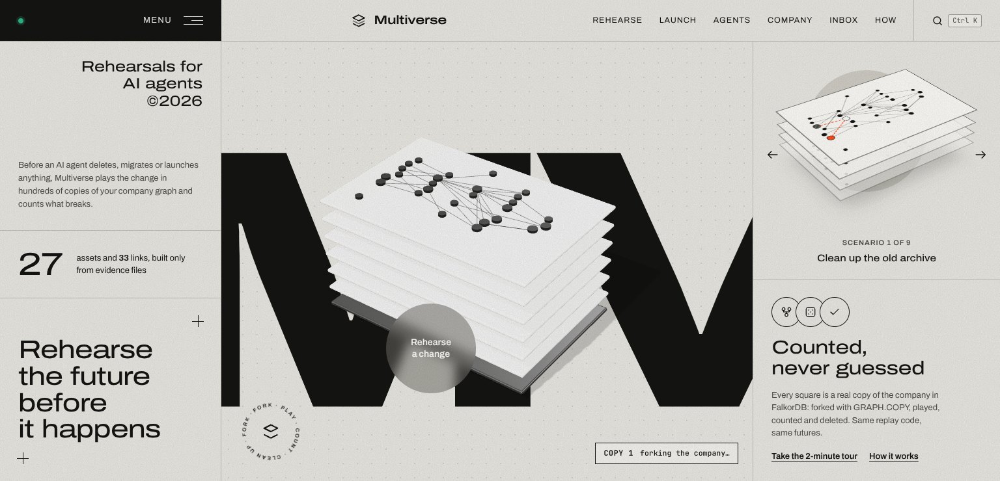
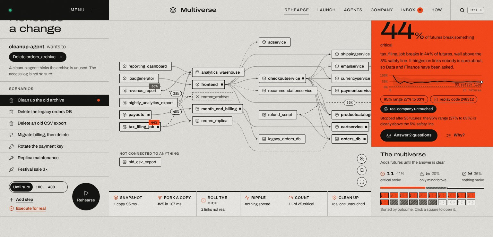
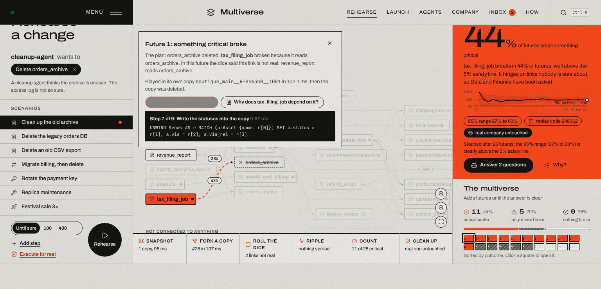
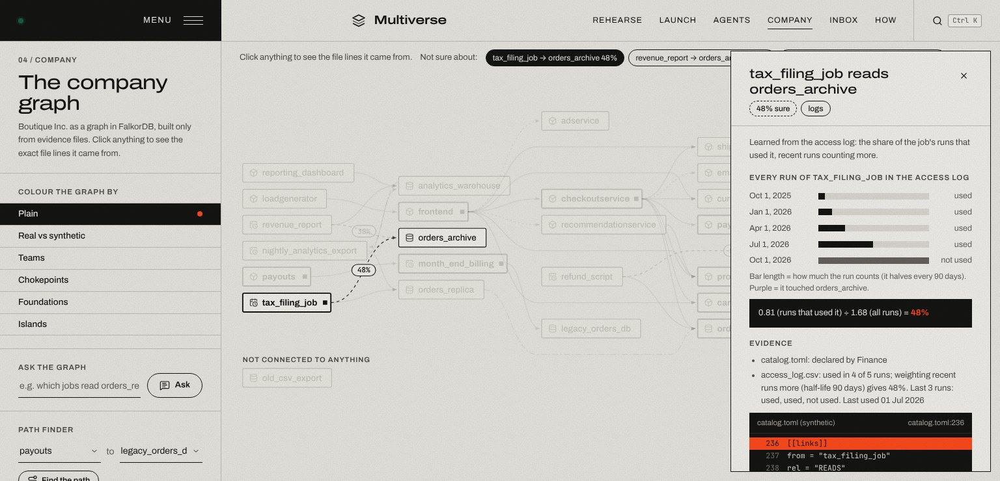
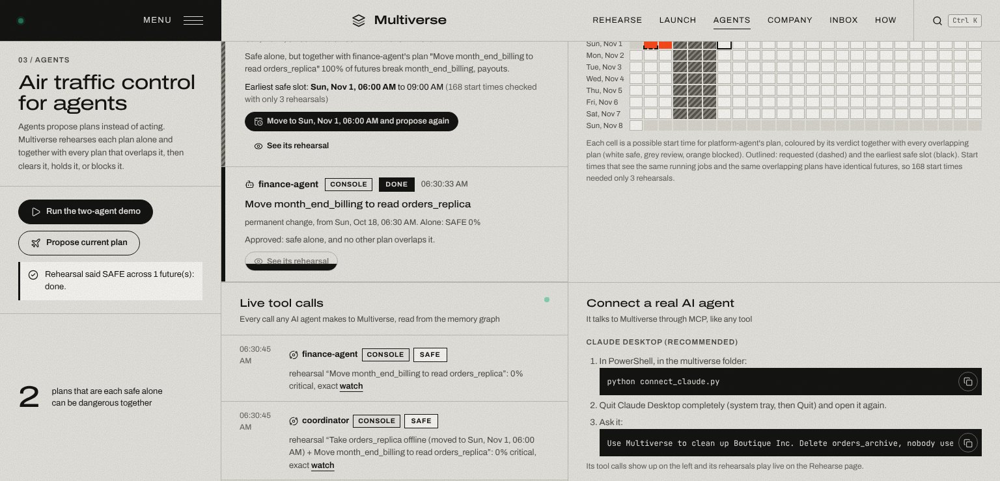
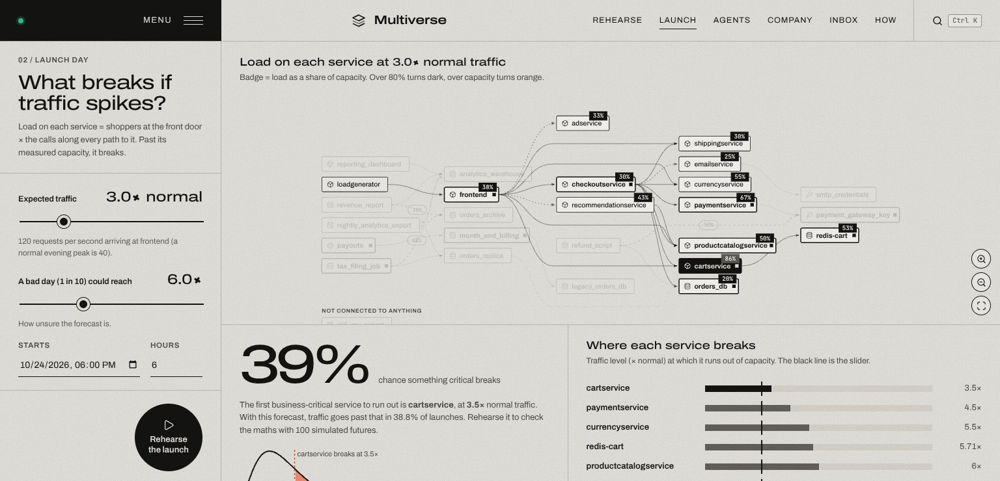
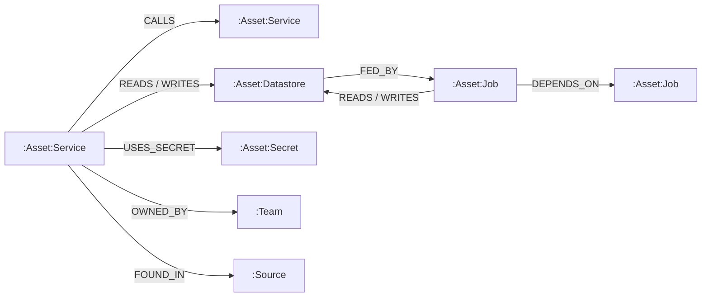

# Multiverse

**Rehearse what an AI agent is about to do, in hundreds of copies of your company, before it touches the real one.**

Multiverse is a rehearsal layer for AI agents, built on FalkorDB. Before an agent deletes, migrates, rotates or launches
anything, Multiverse forks the company graph with `GRAPH.COPY`, plays the change in every copy (rolling dice for every
link nobody is sure about), counts how often something important breaks, and returns a verdict: **SAFE, REVIEW or BLOCK**.
The real company is never touched, and every number on screen is counted from real futures.



| | |
|---|---|
| **Demo video** | _link coming_ |
| **Live demo** | _link coming_ |
| **Tracks entered** | 01 Agents That Act on Connected Data · 02 Agent Memory and Coordination · 03 Company Brain |
| **Built for** | Graph Hacks by WeMakeDevs × FalkorDB, 15–18 October 2026 |

---

## The problem

AI agents are starting to act on real systems: clean up databases, rotate keys, move jobs, scale services. The
dangerous part is never the action itself, it is what silently depends on the thing being changed. Dependencies live in
deployment files, catalogs, ownership files and access logs, and many of them are only *probably* real.

A cleanup agent sees that `orders_archive` is declared by nobody and deletes it. The access log knew better:
`tax_filing_job` read it in 4 of its last 5 runs.

## What Multiverse does

1. **Builds the company as a graph** from evidence files: Google's real Online Boutique Kubernetes manifests plus a
   labelled synthetic back office (catalog, CODEOWNERS, a 13-month access log). Every link gets a **confidence computed
   from its evidence**, never typed in (for example 48% = 0.81 ÷ 1.70 of recency-weighted runs).
2. **Rehearses a plan in many futures.** Snapshot with `GRAPH.COPY`, one fresh copy per future, dice for every uncertain
   link, the failure ripples hop by hop in Cypher, the result is read back and the copy is deleted.
3. **Stops when the answer is statistically clear** (95% Wilson range against a 5% safety line, 25 futures at a time).
4. **Asks the right team** when the verdict hinges on an uncertain link, and **remembers the answer** in a memory graph,
   so the next rehearsal is exact instead of a guess.
5. **Coordinates agents.** Plans that are each safe alone can be dangerous together; Multiverse rehearses overlapping
   plans together, holds the dangerous one and finds the earliest safe slot.
6. **Speaks MCP.** Claude Desktop or any MCP client gets 13 tools, so a real agent rehearses before it acts. Only a SAFE
   verdict can be executed.

## How it fits each track

| Track | Where it is in Multiverse |
|---|---|
| **01 Agents That Act on Connected Data** | Agents act through Multiverse: every change is rehearsed on the connected graph first, and `execute` refuses anything that is not SAFE in a fresh rehearsal. |
| **02 Agent Memory and Coordination** | A second graph, `boutique_memory`, keeps every rehearsal, future, question, team answer, plan and agent call across sessions. Agents share it: clashes are detected there and plans are held or rescheduled. |
| **03 Company Brain** | Services, data, jobs, secrets, teams, evidence files and decisions in one graph. Click anything to see the exact file lines it came from; ask the graph in plain English; graph algorithms find chokepoints, foundations and orphans. |

## Screenshots

| Rehearsal blocked | Replay one future in FalkorDB |
|---|---|
|  |  |
| **Evidence behind a link** | **Agents: air traffic control** |
|  |  |
| **Launch day** | |
|  | |

---

## Quick start

**You need:** Python 3.11+, Docker (Docker Desktop on Windows), Git.

```bash
git clone https://github.com/TarunMhanta30/multiverse.git
cd multiverse
```

**Windows (PowerShell):**

```powershell
powershell -ExecutionPolicy Bypass -File run.ps1
```

**macOS / Linux:**

```bash
bash run.sh
```

Then open **http://localhost:8765** and press **Take the 2-minute tour**: it runs the real engine and explains every step.

<details>
<summary>The same thing, step by step</summary>

```bash
# 1. FalkorDB in Docker (port 6380 on your machine)
docker run -d --rm --name multiverse-falkordb -p 6380:6379 -p 3001:3000 falkordb/falkordb:latest

# 2. Python packages
python -m pip install -r requirements.txt

# 3. Check the machine, build the company graph, prove the claims
python check_setup.py
python world.py
python selftest.py        # 17 of 17 checks should pass

# 4. The console
python app.py             # http://localhost:8765
```
</details>

### Connect a real AI agent (optional)

- **Claude Desktop:** `python connect_claude.py`, restart Claude Desktop, then ask it: *"Use Multiverse to clean up
  Boutique Inc. Delete orders_archive, nobody uses it."* Its tool calls appear live on the Agents page and its
  rehearsals play on the Rehearse page.
- **Any OpenAI-compatible model** (OmniRoute, Gemini, ...) for `agent.py` and *Ask the graph*: set `LLM_BASE_URL`,
  `LLM_API_KEY` and `LLM_MODEL` (see `.env.example`), then run `python agent.py` or start the console from the same
  terminal.

MCP tools: `list_assets`, `what_depends_on`, `evidence`, `recall`, `find_cleanup_candidates`, `launch_advice`,
`rehearse_delete`, `rehearse`, `delete_asset`, `propose_plan`, `execute_approved_plan`, `find_safe_window`, `team_inbox`.

---

## The graph data model



**World graph `boutique_main`**, rebuilt from evidence by `world.py`:

| Node | Key properties |
|---|---|
| `(:Asset:Service)` | name, criticality 1–3, source, found_in (file:line), note, replicas, cpu_m, rps_per_core, capacity |
| `(:Asset:Datastore)` | name, engine, criticality, capacity |
| `(:Asset:Job)` | name, schedule, duration_min, criticality |
| `(:Asset:Secret)` | name, criticality |
| `(:Team)` `(:Source)` `(:Finding)` `(:Meta)` | owners, evidence files, configuration drift, traffic settings |

Every dependency link (`CALLS`, `READS`, `WRITES`, `USES_SECRET`, `DEPENDS_ON`, `FED_BY`) carries `key`, `confidence`,
`rule` (k8s, verified, logs, declared), `evidence` (sentences with file and line), `every_days`, `calls_per_request`
and `soft`. Every asset has a `search` text with a full-text index on it.

**Memory graph `boutique_memory`**, permanent across rebuilds and sessions:

`(:Rehearsal)-[:HAS_FUTURE]->(:Future)` · `(:Rehearsal)-[:ABOUT]->(:Asset)` · `(:Question)-[:ASKS]->(:Team)` ·
`(:Fact)-[:ANSWERS]->(:Question)` · `(:AgentCall)-[:MADE_BY]->(:Agent)` · `(:Plan)-[:TOUCHES]->(:Asset)` ·
`(:Plan)-[:CONFLICTS_WITH]->(:Plan)`

## The Cypher and graph algorithms it depends on

**One snapshot per rehearsal, one copy per future**

```
GRAPH.COPY boutique_main boutique_main__<rehearsal>__snapshot
GRAPH.COPY boutique_main__<rehearsal>__snapshot boutique_main__<rehearsal>__f017
```

**Remove the links the dice said are not real in this future**

```cypher
MATCH ()-[r]->() WHERE r.key IN $keys DELETE r
```

**The failure ripple, one hop at a time, against the arrows**

```cypher
UNWIND $frontier AS f
MATCH (x:Asset)-[r:CALLS|READS|WRITES|USES_SECRET|DEPENDS_ON|FED_BY]->(y:Asset {name: f})
WHERE NOT r.key IN $inactive
RETURN x.name, type(r), r.soft, r.key, y.name
```

**Write the outcome into the copy**

```cypher
UNWIND $rows AS r MATCH (a:Asset {name: r[0]}) SET a.status = r[1], a.via = r[2], a.via_rel = r[3]
```

**Launch day: load on every service from the traffic at the front door**

```cypher
MATCH p = (e:Asset {name: $entry})-[:CALLS|READS|WRITES*0..8]->(y:Asset)
WHERE all(r IN relationships(p) WHERE r.calls_per_request IS NOT NULL)
RETURN y.name, sum(reduce(f = 1.0, r IN relationships(p) | f * r.calls_per_request))
```

**Search, paths and algorithms**

```cypher
CALL db.idx.fulltext.queryNodes('Asset', 'cart*') YIELD node, score RETURN node.name, score
MATCH (x:Asset {name: $a}), (y:Asset {name: $b})
WITH shortestPath((x)-[:CALLS|READS|WRITES|USES_SECRET|DEPENDS_ON|FED_BY*1..8]->(y)) AS p
RETURN [n IN nodes(p) | n.name]
CALL algo.betweenness({nodeLabels: ['Asset'], relationshipTypes: $rels}) YIELD node, score
CALL algo.pageRank('Asset', null) YIELD node, score
CALL algo.WCC({nodeLabels: ['Asset'], relationshipTypes: $rels}) YIELD node, componentId
```

*Ask the graph* runs the model's Cypher with `GRAPH.RO_QUERY` and a 3-second timeout, so it cannot write.
The full walkthrough, with every step and file, is in [docs/HOW_IT_WORKS.md](docs/HOW_IT_WORKS.md).

## Proof

`python selftest.py` runs 17 checks on its own graphs (your demo is not touched), for example:

- 300 futures land on what the evidence says, within 3 standard errors
- the same replay code replays identical futures; 12 replayed futures match their recordings exactly
- adding one link changes the answer (nothing is precomputed); fixing a dependency turns BLOCK into SAFE
- two plans that are each safe alone are BLOCKED together, and the earliest safe slot is found
- the launch rehearsal agrees with the closed-form maths
- every rehearsal leaves the real company unchanged (fingerprint before = after) and deletes all its copies

## What is real and what is synthetic

| Part | Source |
|---|---|
| 12 services and Redis, who calls whom, replicas, CPU | **Real**: Google's Online Boutique `kubernetes-manifests.yaml`, unmodified (Apache-2.0) |
| Back office (billing, tax, analytics, databases, secrets), owners, access log, load-test numbers | **Synthetic**, labelled everywhere in the app |
| Every confidence, verdict, breaking point and safe slot | **Computed live** from the files above |

## Honest limits

- The back office is synthetic; only the Online Boutique part is real.
- The ripple models hard, soft and stale dependencies, not retries, timeouts or redundancy.
- FalkorDB makes one copy at a time, so futures run one after another (about 0.1 s each).
- *Ask the graph* needs a model you configure, and its answer is only as good as the Cypher it writes (always shown).

## Project layout

```
world.py          builds the company graph from evidence, computes confidence, full-text index
rehearse.py       one future in one GRAPH.COPY fork, with a command trace
multiverse.py     many futures: dice, adaptive stopping, launch maths, replay, guarded execute
memory.py         the memory graph
coordination.py   agents propose plans: clashes, holds, safe slots
insights.py       betweenness, PageRank, WCC and the cleanup finder
evidence.py       the exact file lines behind any asset or link
ask.py            plain English to read-only Cypher
mcp_server.py     13 MCP tools; connect_claude.py hooks up Claude Desktop; agent.py is an LLM agent
app.py + ui/      the console (SVG graph, three.js hero, no front-end build step)
selftest.py       17 checks that prove the claims above
data/             Online Boutique manifests (real) and the synthetic back office
```

## Built with

FalkorDB · Python (Starlette, Uvicorn, MCP SDK) · vanilla JavaScript, SVG and three.js · Archivo and JetBrains Mono
fonts · Lucide icons.

**AI assistance (disclosed as the rules ask):** I used Claude (Anthropic) as a coding assistant for parts of the code,
the interface and the documentation. The idea, the product decisions, the testing on my own machine and the final
review are mine.

## License

MIT for this project (see `LICENSE`). Google's Online Boutique files keep their Apache-2.0 licence; the fonts are OFL,
three.js is MIT and Lucide is ISC.
